# **DB Workbench**

!!! info 
    The DB Workbench is an integrated tool within INGenious that allows users to connect to a database, browse schemas, run SQL queries, and validate results in a streamlined and user-friendly interface—similar to tools like DBeaver or DataGrip. It enables teams to easily manage database connections, execute SELECT and DML statements, inspect result grids, and turn query results into automated database assertions.

## How to use the DB Workbench:

The DB Workbench can be accessed via the Menu Ribbon:

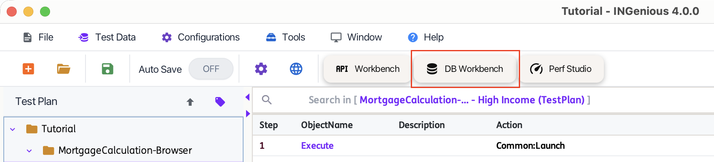{ width="60%" }

Once selected, you will be navigated to the DB Workbench window. See example below:

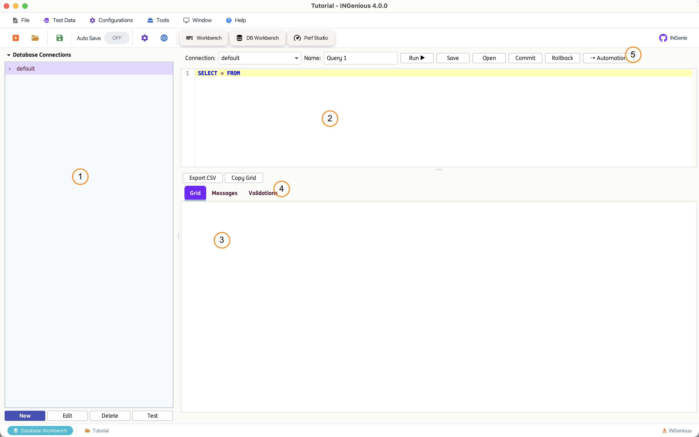

!!! tip ""
    The numbered areas highlighted in the image above are explained in the sections below. Use the tabs to explore the purpose and functionality of each part of the DB Workbench.

=== ":one: Connections Pane"
    This is where database **Connections** are created, organized, and browsed. Every connection is backed by a `Settings/Databases/<alias>.properties` file in the project—the same connection store used by the [Database](database.md) engine actions, so a connection created here can be reused directly by generated tests.

    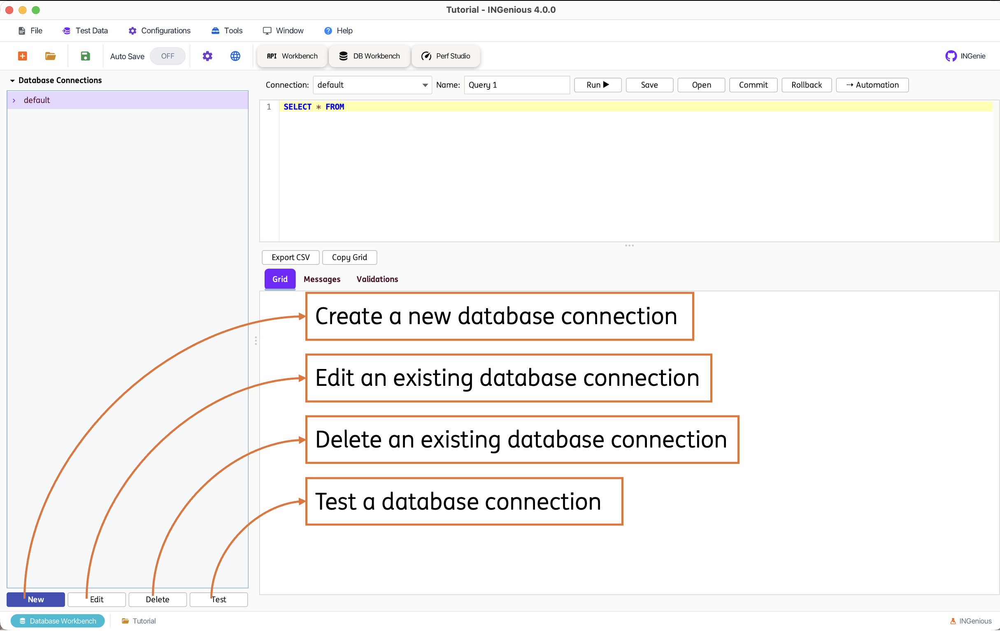

    Use the **New**, **Edit**, **Delete**, and **Test** buttons at the bottom of the pane to manage connections:

    * **New** – Opens the connection dialog to configure a new database connection.
    * **Edit** – Edit the alias, connection string, credentials, and other options of the selected connection. The alias itself (the properties file name) cannot be changed once created.
    * **Delete** – Removes the selected connection. The `default` connection is protected and cannot be deleted.
    * **Test** – Attempts to connect using the currently saved details and reports success or failure.

    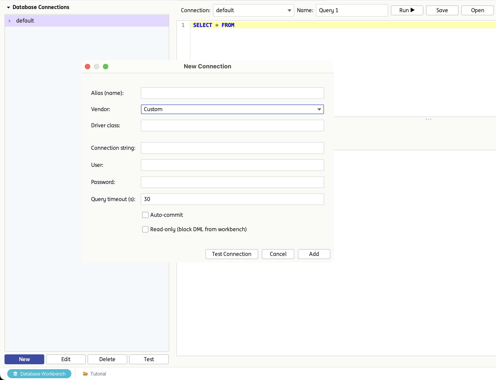{ width="60%" }

    The connection dialog supports common vendor presets, which automatically fill in the driver class and a connection-string template:

    * **PostgreSQL**
    * **MySQL**
    * **MariaDB**
    * **SQL Server**
    * **Oracle**
    * **H2**
    * **SQLite**
    * **DB2**
    * **Custom** – manually specify any JDBC driver class and connection string.

    Additional options available per connection:

    * **User / Password** – Credentials used to authenticate. Passwords are stored encrypted.
    * **Query timeout (s)** – Maximum time, in seconds, a query is allowed to run before it is cancelled.
    * **Auto-commit** – When enabled, each statement is committed automatically; when disabled, use the **Commit** / **Rollback** actions in the Query Editor to manage the transaction manually.
    * **Read-only** – When enabled, DML statements (`INSERT`/`UPDATE`/`DELETE`/`MERGE`) are blocked from being executed through the Workbench for that connection, protecting the database from accidental writes.

    If a required JDBC driver is not available on the classpath, the dialog shows a warning with the recommended driver jar and Maven coordinates to add.

    !!! tip "Naming connections"
        Use descriptive, environment-specific aliases (for example `qaOrders`, `stagingBilling`) so the correct connection is easy to identify both in the Workbench and when reviewing generated test steps.

    !!! note "Shared with Database Configurations"
        Connections created here appear under **Database Configurations** in the Configuration window, and vice versa. See [Database Testing](database.md) for details on configuring connections from Settings, including dynamic property values and user-added properties.

    **Browsing the Schema**

    Expanding a connection in the tree lazily loads its tables and views. **Double-clicking** a table automatically generates a `SELECT * FROM <table>` statement into the Query Editor, and the table/column names are added to the SQL editor's autocomplete suggestions.

    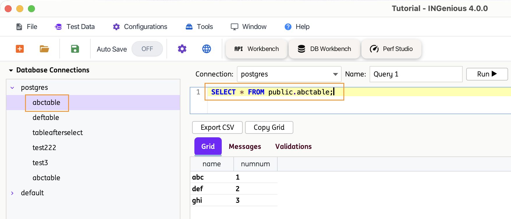{ width="60%" }

=== ":two: Query Editor Pane"
    This section allows you to select a connection and write the SQL statement you want to execute.

    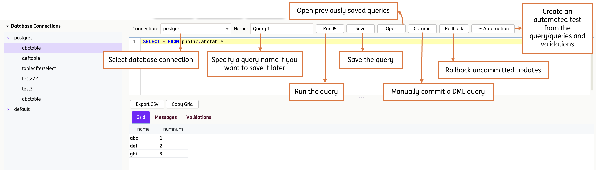

    The toolbar provides the following actions:

    * **Connection** – Select which saved connection the query should run against.
    * **Name** – Name used when the query is saved.
    * **Run ▶** – Executes the SQL in the editor, or just the selected text if a portion of the statement is highlighted.
    * **Save** – Saves the current query (SQL, connection, and any configured validations) into the project.
    * **Open** – Opens a previously saved query into the editor.
    * **Commit** / **Rollback** – Commits or rolls back the current transaction on the selected connection. Useful when **Auto-commit** is disabled for that connection.
    * **⇢ Automation** – Converts the current query, together with its configured validations, into an INGenious Test Case or User Intent.

    The editor supports SQL syntax highlighting, code folding, and autocomplete for common SQL keywords as well as table and column names discovered from the connected schema.

    It supports both read and write statements:

    * **SELECT** – Retrieve data from the database.
    * **INSERT / UPDATE / DELETE / MERGE** – Detected automatically as DML statements. These are blocked if the selected connection is marked **Read-only**.

=== ":three: Result Grid Pane"

    This section displays the outcome of the executed statement. The pane is organised into three tabs—**Grid**, **Messages**, and **Validations**—and a status bar at the bottom that always reflects the most recent execution.

    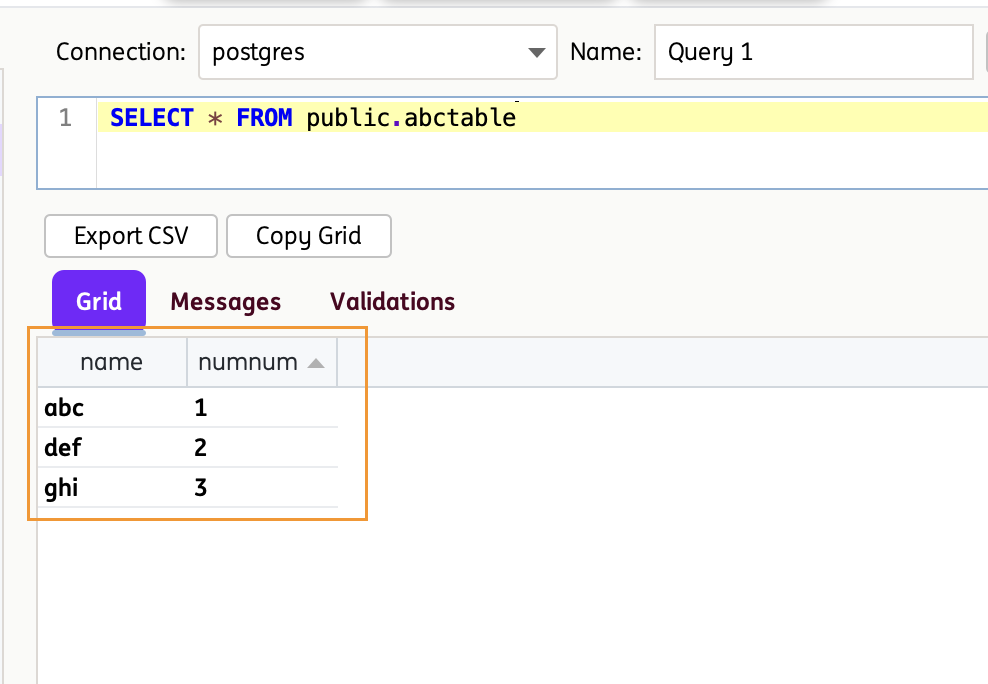

    **Grid Tab**

    For `SELECT` statements, the Grid tab renders the returned result set, with one column per column in the result and one row per record returned.

    * **Column headers** are taken directly from the result-set metadata, so aliased columns (for example `SELECT name AS customerName`) appear under the alias used in the query.
    * **Sorting** is available by clicking a column header. Sorting only re-orders the displayed rows—it does not re-execute the query, and the original row numbers are retained when building validations.
    * **Cell selection** is enabled, so individual cells, rows, or columns can be selected for inspection or for building a validation.
    * `NULL` values are shown as empty cells. To distinguish an empty string from a true `NULL`, use the **Assert value is NULL** / **Assert value is NOT NULL** options described in the Validations tab.

    The Grid tab is automatically brought to the front whenever a `SELECT` statement completes successfully.

    **Grid Toolbar**

    Two actions are available above the result tabs:

    * **Export CSV** – Saves the entire displayed result set to a `.csv` file of your choosing. Values containing commas, quotes, or line breaks are escaped automatically so the file opens correctly in spreadsheet tools.
    * **Copy Grid** – Copies the entire displayed result set to the clipboard in CSV format, ready to paste into a spreadsheet, a ticket, or a test-evidence document.

    **Messages Tab**

    The Messages tab is the diagnostic view for the Workbench. It is brought to the front automatically for anything that does not produce a result grid, and it displays:

    * Row counts and elapsed execution time for `SELECT` statements.
    * Affected row counts and elapsed execution time for DML statements.
    * Confirmation of **Commit** and **Rollback** actions, including the connection alias they were applied to.
    * Confirmation when a query is saved.
    * Errors—SQL syntax problems, connection failures, timeouts, and blocked DML on read-only connections—shown in red, without an interrupting pop-up dialog.

    **Status Bar**

    The status bar beneath the tabs gives an at-a-glance summary of the last execution, such as `25 row(s) in 143 ms` or `3 row(s) affected in 58 ms`.

    !!! note "Row limit"
        To keep the IDE responsive, the Grid displays a maximum of **1000 rows** per execution. When a query returns more than this, the status bar appends `(truncated to max rows)`. Refine the query with a `WHERE` clause or a `LIMIT` / `TOP` / `FETCH FIRST` restriction to see the rows you are interested in.

    !!! tip "Query timeouts"
        Each execution is bound by the **Query timeout (s)** value configured on the selected connection. If a long-running query is cancelled, the reason is reported in the Messages tab—increase the timeout on the connection if the query legitimately needs more time.

=== ":four: Validations"

    Validations are the bridge between exploratory querying and automated testing. Each validation is a rule describing something that must be true about the result set—or a value that should be captured for later use—and each one becomes a single test step when the query is converted to automation.

    **Creating a Validation**

    After executing a `SELECT` query, **right-click** directly on a cell in the Grid tab. The Workbench reads the cell's **column name**, **row number**, and **value**, and pre-fills the rule for you, so in most cases a validation can be created in a single click.

    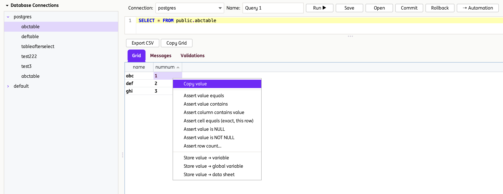{ width="60%" }

    The context menu also offers **Copy value**, which copies just the selected cell's value to the clipboard.

    **Assertion Options**

    | Option | What it checks | Generated action |
    | --- | --- | --- |
    | **Assert value equals** | The value exists somewhere in the selected column | `assertDBResult` |
    | **Assert value contains** | The value exists somewhere in the selected column | `assertDBResult` |
    | **Assert column contains value** | The value exists somewhere in the selected column | `assertDBResult` |
    | **Assert cell equals (exact, this row)** | The value at the exact column *and* row matches exactly | `assertColumnValueEquals` |
    | **Assert value is NULL** | The value at the exact column and row is SQL `NULL` | `assertColumnValueIsNull` |
    | **Assert value is NOT NULL** | The value at the exact column and row is not SQL `NULL` | `assertColumnValueIsNotNull` |
    | **Assert row count…** | The query returns exactly the expected number of rows | `assertRowCount` |

    !!! info "Column-wide versus cell-specific assertions"
        The first three options scan the **entire column** for the value and pass if it is found in any row—useful when row order is not guaranteed. **Assert cell equals** is row-specific and only passes when the value sits at that exact column and row position.

    When you choose **Assert row count…**, the Workbench prompts for the expected number of rows and pre-fills it with the row count currently shown in the grid.

    **Store Options**

    In addition to assertions, values can be captured from the result set and reused elsewhere in your test suite:

    | Option | Purpose | Generated action |
    | --- | --- | --- |
    | **Store value → variable** | Stores the value in a runtime variable (for example `%dbValue%`), available to later steps in the same test case | `storeValueInVariable` |
    | **Store value → global variable** | Stores the value in a global variable (for example `%dbValue%`), available across test cases | `storeValueInGlobalVariable` |
    | **Store value → data sheet** | Writes the value into a Test Data sheet using a `Sheet:Column` reference (for example `DbData:orderId`) | `storeDBValueinDataSheet` |

    Each store option prompts for the target name and suggests a sensible default—`%dbValue%` for variables, and `DbData:<columnName>` for data sheets.

    **Managing Validations**

    All rules you create are listed in the **Validations** tab, which is brought to the front automatically each time a new rule is added. The table shows four columns:

    * **Column** – The result-set column the rule applies to.
    * **Row** – The 1-based row number the value was taken from.
    * **Operator** – The type of rule, for example `EQUALS`, `CELL_EQUALS`, `IS_NULL`, `ROW_COUNT`, or `STORE_VAR`.
    * **Expected / Target** – The expected value for assertions, or the target variable / data-sheet reference for store rules.

    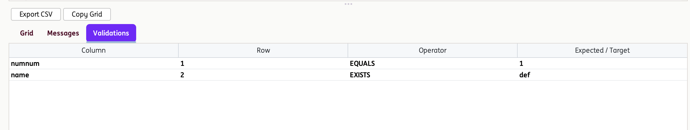

    To delete a rule, **right-click** it in the Validations tab and choose **Remove selected validation**.

    **Persistence and Conversion**

    Validations belong to the query, not to a single execution:

    * They are saved together with the query when you click **Save**, and restored when the query is opened again.
    * They are **not** cleared when you re-run the query, so you can refine the SQL and re-execute while keeping the rules you have already built.
    * Opening a different saved query clears the validation list so rules are never mixed between queries.
    * Every **enabled** validation produces exactly one test step when the query is converted to automation, in the order it appears in the table.

    !!! tip "Build validations last"
        Get the query returning the rows you want first, then build validations from the final result set. This keeps the column names and row positions in the rules aligned with what the automated test will actually see at runtime.

=== ":five: Convert Query to Test Case"

    Queries can be converted directly into INGenious test cases, allowing database validations to be incorporated into automated test suites with minimal effort.

    During conversion, you can choose the target artifact type:

    * **Test Case** – creates a standalone test case in the Test Plan.
    * **User Intent** – creates a [User Intent](../home/userIntent.md) instead, so the converted query can be executed from any number of test cases via the `Execute` action.

    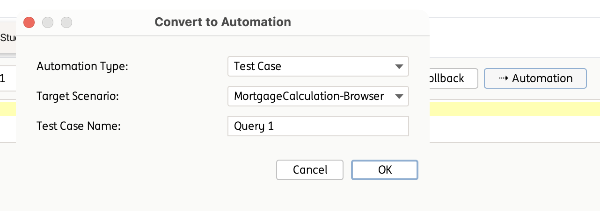{ width="60%" }

    During conversion, the following [Database](database.md) engine steps are generated automatically:

    1. **Initiate the DB transaction** (`initDBConnection`) – opens the connection using the selected alias.
    2. **Execute Select query** or **Execute DML query** (`executeSelectQuery` / `executeDMLQuery`) – runs the configured SQL statement.
    3. One step per enabled validation, for example `assertDBResult`, `assertColumnValueEquals`, `assertColumnValueIsNull`, `assertColumnValueIsNotNull`, `assertRowCount`, `storeValueInVariable`, `storeValueInGlobalVariable`, or `storeDBValueinDataSheet`.
    4. **Close the DB Connection** (`closeDBConnection`) – closes the connection at the end of the test case.

    **Variables**

    If a validation stores a value into a runtime variable, global variable, or data sheet, that reference (for example `%dbValue%` or `Sheet:Column`) is carried over as-is into the generated test case, so it can be reused by later steps.

    The original saved query is not modified by the conversion; it remains available to be opened, edited, or converted again.

    **Converted Test Case Example**

    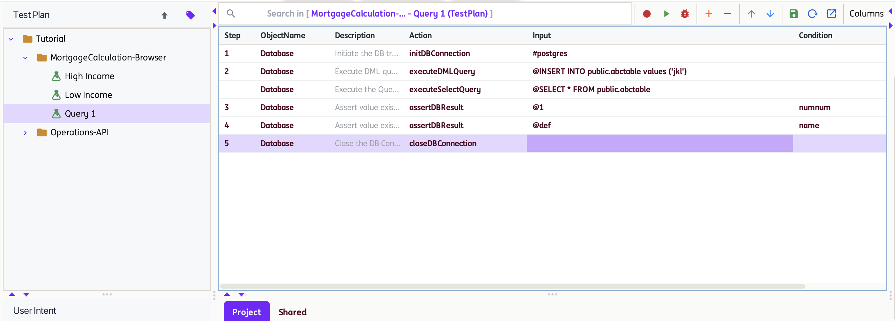

    The generated test case performs the same SQL execution as the DB Workbench query and can be executed within INGenious to validate the expected data and assertions.
